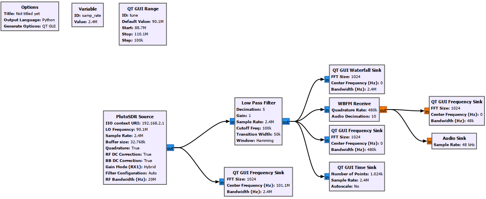
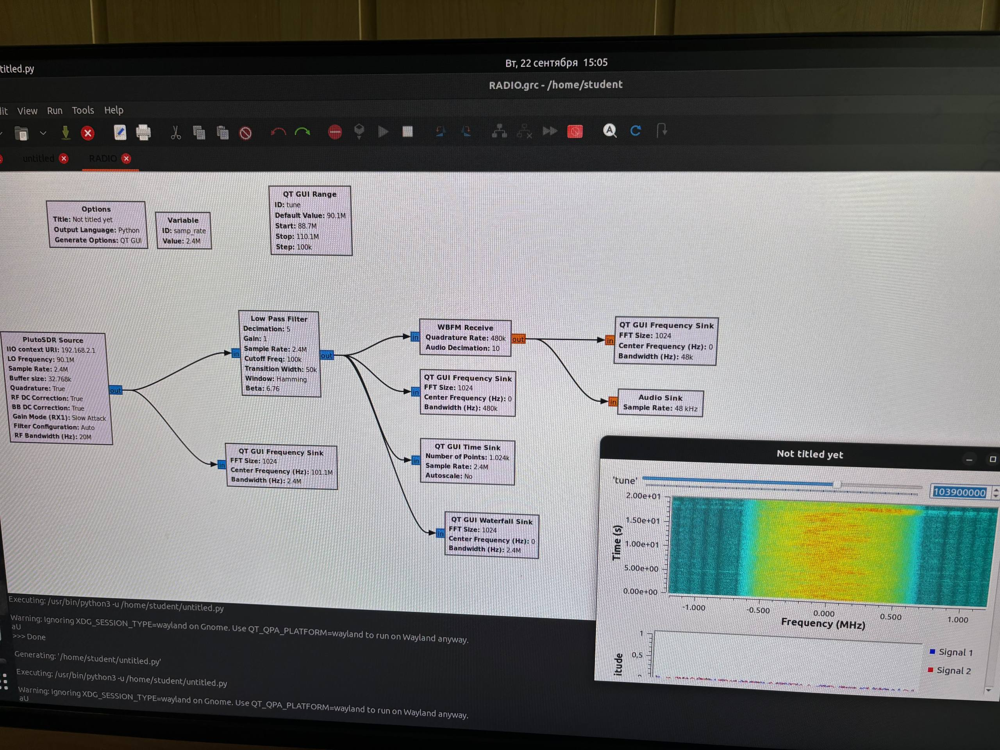
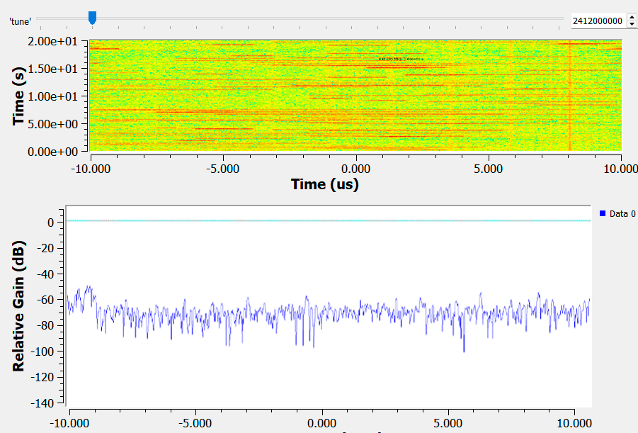

# Тема практической работы: Архитектура Adalm Pluto SDR. GNU Radio. Построение радио-приёмника

## Цель работы

1. Изучить архитектуру Adalm Pluto SDR.
2. Освоить GNU Radio Companion (GRC).
3. Собрать FM-радиоприёмник и анализатор Wi-Fi диапазона 2,4 ГГц на базе Adalm Pluto.

## Теория

**ADALM-PLUTO** — программно-определяемая радиосистема на базе трансивера Analog Devices AD9363 (диапазон 325 МГц – 3,8 ГГц, полоса до 20 МГц, 12-битные АЦП/ЦАП)
и SoC Xilinx Zynq 7000 (ARM Cortex-A9 + ПЛИС). Приёмник переносит сигнал на нулевую частоту и выдаёт квадратурные отсчёты I и Q.

**GNU Radio** — инструмент с открытым исходным кодом для программно-определяемого радио. Схема обработки собирается в графической среде GNU Radio Companion из готовых блоков
(фильтры, демодуляторы, анализаторы спектра), без написания кода.

**Спектрограмма (водопад)** — спектр во времени: по горизонтали частота, по вертикали время, цвет — мощность.

**Wi-Fi 2,4 ГГц (IEEE 802.11b/g/n):** центральные частоты каналов идут с шагом 5 МГц (канал 1 — 2412 МГц), ширина канала около 20 МГц, соседние каналы перекрываются.
Данные передаются короткими пакетами, поэтому мощность в канале меняется во времени.

## Ход работы

### 1. FM-приёмник

Схема сохранена в [grc/fm_radio.grc](../grc/fm_radio.grc).

| Блок | Параметры |
|---|---|
| Variable `samp_rate` | 2,4 МГц |
| QT GUI Range `tune` | 88,7…110,1 МГц, шаг 100 кГц, по умолчанию 90,1 МГц |
| PlutoSDR Source | URI `192.168.2.1`, частота `tune`, частота дискретизации 2,4 МГц, буфер 32,768k, RF bandwidth 20 МГц, RF и BB DC Correction включены |
| Low Pass Filter | децимация 5, усиление 1, частота среза 100 кГц, переходная полоса 50 кГц, окно Hamming (на выходе 480 кГц) |
| WBFM Receive | quadrature rate 480 кГц, audio decimation 10 (на выходе 48 кГц) |
| Audio Sink | 48 кГц |
| QT GUI Frequency Sink / Time Sink / Waterfall Sink | спектр до и после фильтра, осциллограмма и водопад |

  

После запуска ползунком `tune` выбирается частота станции, и передача воспроизводится в динамиках. На водопаде виден канал FM-станции.

  

### 2. Wi-Fi анализатор

Схема сохранена в [grc/wifi.grc](../grc/wifi.grc). Источник — тот же PlutoSDR Source, но с другими параметрами:

| Блок | Параметры |
|---|---|
| Variable `samp_rate` | 20 МГц |
| QT GUI Range `tune` | 2,4…2,5 ГГц, шаг 5 МГц, по умолчанию 2,412 ГГц |
| PlutoSDR Source | частота `tune`, частота дискретизации 20 МГц, RF bandwidth 20 МГц |
| QT GUI Waterfall Sink | спектрограмма принятого сигнала |

Ползунком выбирается канал Wi-Fi, на спектрограмме наблюдаются всплески мощности — пакеты точки доступа.

  

## Вывод

В ходе работы я изучил архитектуру Adalm Pluto SDR, освоил GNU Radio Companion, собрал и настроил FM-приёмник, а также построил анализатор диапазона 2,4 ГГц,
на котором видна пакетная передача Wi-Fi.
