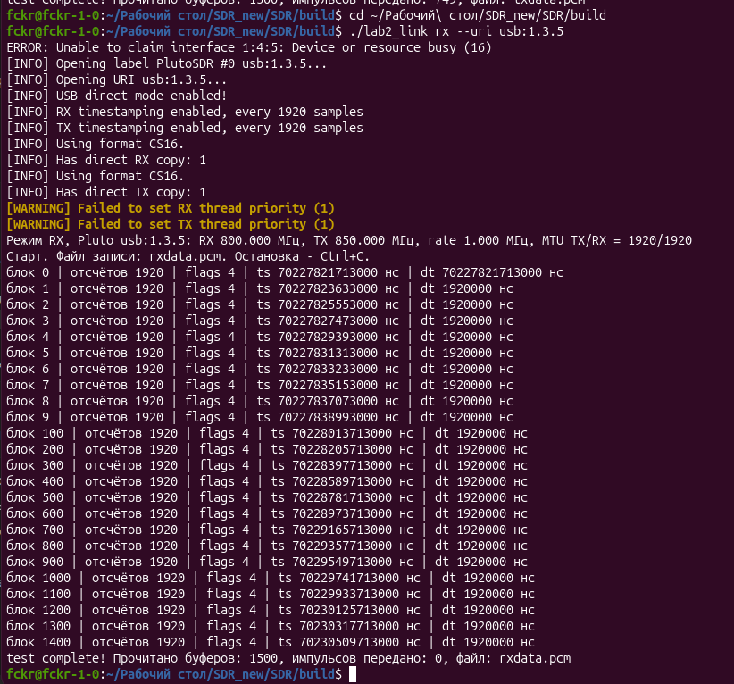
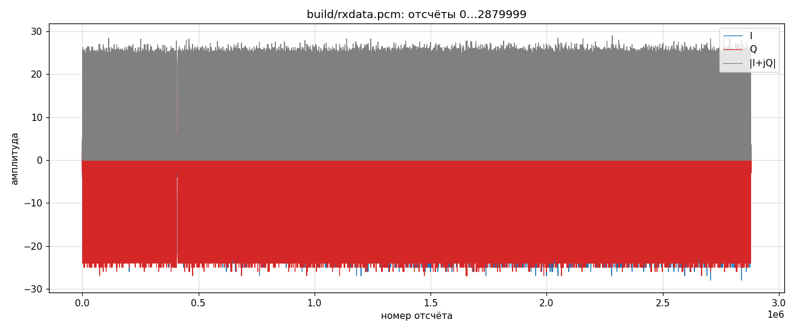
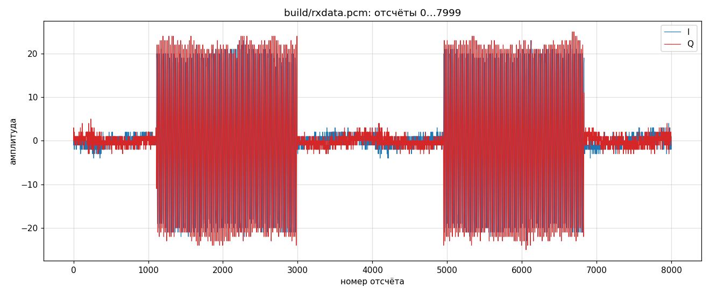
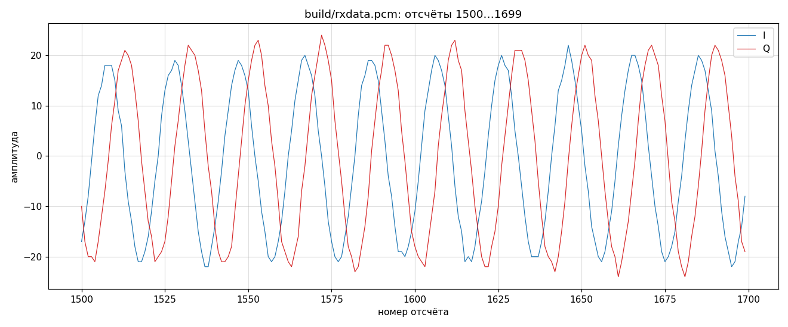

# Тема практической работы: Приём и передача сэмплов на двух Adalm Pluto SDR

## Цель работы

1. Настроить приём и передачу между двумя устройствами Adalm Pluto SDR через библиотеку SoapySDR на языке C++.
2. Передать тестовый сигнал по метке времени и сохранить принятые данные.
3. Рассмотреть на графиках составляющие сигнала I и Q.

## Теория

**SoapySDR** — слой абстракции над SDR-устройствами. Для Pluto используется драйвер SoapyPlutoSDR из ветки с аппаратными метками времени
(`sdr_gadget_timestamping`): в режиме `direct = 1` буферы передаются без промежуточного копирования, а каждые `timestamp_every = 1920` отсчётов
приходит метка времени из ПЛИС. Сэмплы имеют формат CS16 — пары 16-битных значений I и Q.

**Передача по времени.** Получив буфер с меткой `T_rx`, передатчик планирует излучение следующего буфера на момент

`T_tx = T_rx + ΔT`, где ΔT = 4 мс.

При вызове `SoapySDRDevice_writeStream` указывается флаг `SOAPY_SDR_HAS_TIME` и время `T_tx`.

**Два устройства.** Если на USB подключены две платы, адрес `usb:` неоднозначен — используются URI вида `usb:1.4.5` (узнаются командой `SoapySDRUtil --find`,
скрипт `scripts/find_sdr.sh`). Чтобы собственный передатчик не «забивал» вход приёмника, частоты приёма и передачи разносят (дуплекс с частотным разделением):

| Режим | Приём | Передача |
|---|---|---|
| `rx` | 800 МГц | 850 МГц |
| `tx` | 850 МГц | 800 МГц |

Принятый сигнал сохраняется в виде пар I, Q; по ним строятся графики.

## Ход работы

Программа `src/lab2_link.cpp` (общие функции работы с Pluto вынесены в `src/sdr_device.cpp`). Режим (`rx` или `tx`) и адрес устройства задаются в командной строке,
поэтому приём и передача выполняются общим кодом, а режим определяет только частоты и имя файла. Частота дискретизации — 1 МГц.

Порядок работы программы:
1. Создаётся устройство (`driver=plutosdr`, `direct=1`, `timestamp_every=1920`), задаются частоты, частота дискретизации и усиление, открываются потоки RX и TX.
2. В цикле читается буфер из 1920 отсчётов (`SoapySDRDevice_readStream`), запоминается его метка времени.
3. Принятые данные записываются в файл (`rxdata.pcm` для режима `rx`, `txdata.pcm` для `tx`).
4. В режиме `tx` на каждом втором буфере в эфир передаётся тестовый сигнал — комплексный тон 50 кГц (I = A·cos, Q = A·sin), окружённый нулями, — с меткой `T_rx + 4 мс`.
5. Ctrl+C корректно завершает работу: потоки закрываются, файл сбрасывается на диск.

Запуск:
```bash
./lab2_link rx --uri usb:1.4.5     # терминал 1
./lab2_link tx --uri usb:3.4.5     # терминал 2
```

<p align="center">
  
</p>

По сохранённым данным построены графики I и Q (`scripts/plot_iq.py`). Вся запись: до момента передачи принимается шум около нуля, затем виден всплеск I и Q в момент срабатывания передатчика по аппаратной метке времени.

<p align="center">
  
</p>

Увеличенный участок: видны пачки и паузы между ними.

<p align="center">
  
</p>

При ещё большем увеличении видны отдельные колебания I и Q (тон 50 кГц), смещённые на четверть периода друг относительно друга.

<p align="center">
  
</p>

## Вывод

Я настроил приём и передачу между двумя Adalm Pluto SDR, реализовал передачу сэмплов по аппаратной метке времени и сохранил данные с каждого устройства.
По графикам рассмотрел пачки сигнала, колебания I и Q и паузы между ними.
