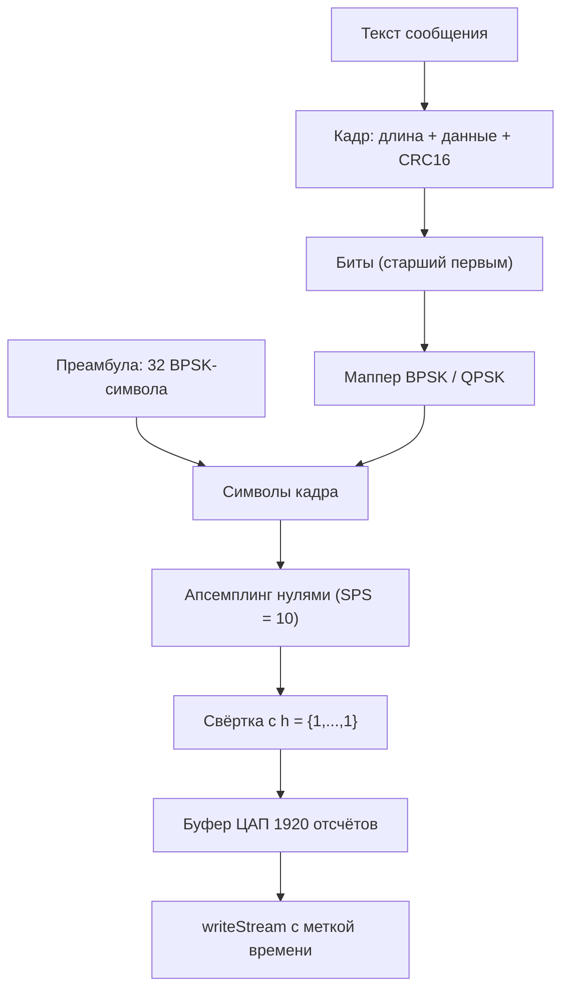
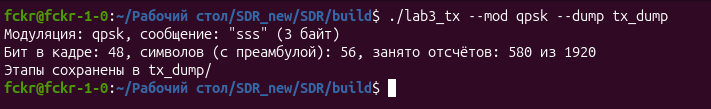
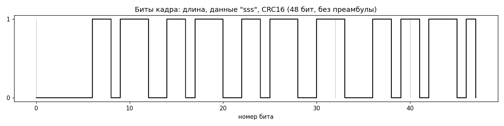
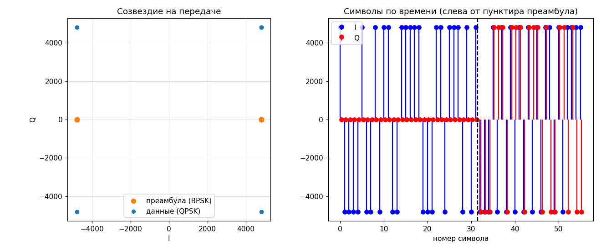
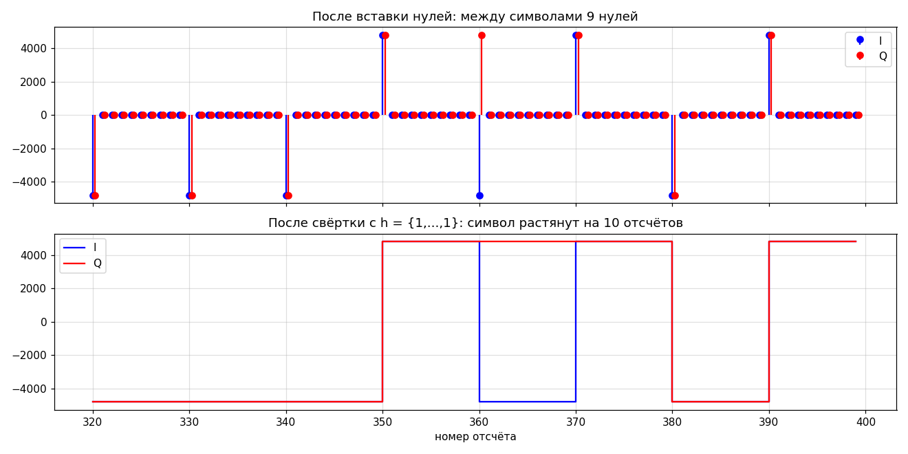
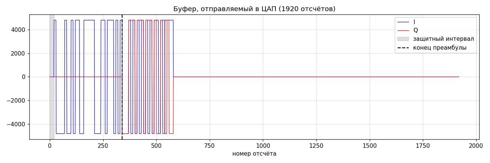
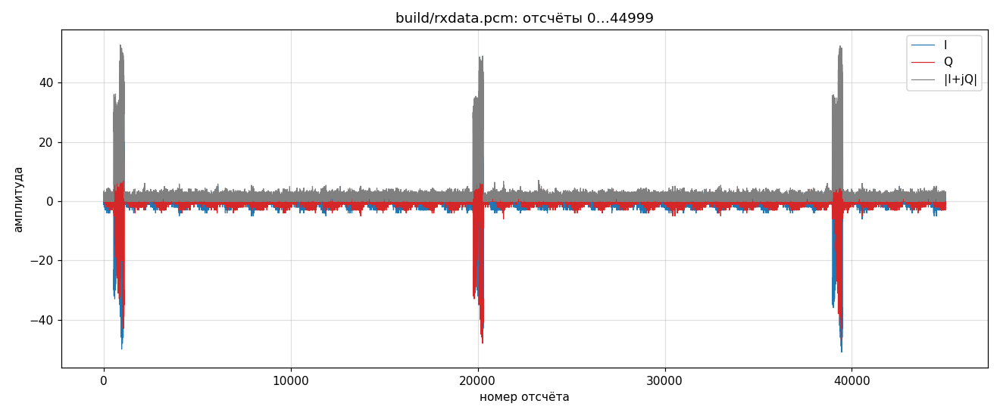

# Тема практической работы: биты -> модуляция -> upsampling -> свёртка -> TX

## Цель работы

1. Реализовать цепочку цифрового передатчика: генерация битов, отображение в символы BPSK/QPSK, апсемплинг, формирующая фильтрация (свёртка).
2. Передать сформированный сигнал по радиоканалу между двумя Adalm Pluto с использованием аппаратных меток времени.
3. Наглядно рассмотреть результат каждого этапа обработки.

## Теория

**Структура передатчика.**



**Генерация битов.** Байты кадра переводятся в биты старшим битом вперёд. Функция `tile_text` повторяет сообщение через пробел до нужной длины;
с параметром `--fill` передатчик так заполняет текстом весь буфер.

**Маппер.** Символ — комплексное число I + jQ. Базовая амплитуда A = `SYMBOL_AMP` = 300·16 = 4800 (ЦАП 12-битный, отсчёты выровнены влево).

* BPSK — 1 бит на символ: бит 1 → I = +A, бит 0 → I = −A, Q = 0.
* QPSK — 2 бита на символ: первый бит задаёт знак I, второй — знак Q (1 → +A, 0 → −A):

| b(2k) | b(2k+1) | (I, Q) |
|:-:|:-:|:-:|
| 1 | 1 | (+A, +A) |
| 1 | 0 | (+A, −A) |
| 0 | 1 | (−A, +A) |
| 0 | 0 | (−A, −A) |

**Апсемплинг.** Чтобы согласовать символьную скорость с частотой дискретизации, на каждый символ приходится SPS = 10 отсчётов. Сначала после каждого символа вставляется SPS − 1 = 9 нулей.
При частоте дискретизации 1 МГц символьная скорость равна 1 МГц / 10 = 100 кСимв/с.

**Формирующий фильтр (свёртка).** Последовательность с нулями сворачивается с импульсной характеристикой h длины SPS:

`y[n] = Σ x_up[n − k]·h[k]`, k = 0…SPS−1, h = {1, 1, …, 1}.

Каждый символ растягивается в прямоугольный импульс длительностью SPS отсчётов.

**Кадр.** Чтобы приёмник мог найти начало передачи и проверить результат, перед данными добавляется **преамбула** — известная последовательность из 32 BPSK-символов (m-последовательность
с «острой» автокорреляцией). После преамбулы идут: один байт длины, данные, два байта CRC-16/CCITT. Весь кадр должен поместиться в один буфер Pluto (1920 отсчётов = 192 символа),
в начале буфера оставлен защитный интервал из 20 нулевых отсчётов. Поэтому текст ограничен: для BPSK — до 16 символов, для QPSK — до 36.

## Ход работы

Реализация: `include/tx_dsp.hpp`, `src/tx_dsp.cpp`, `src/frame.cpp`; программа `src/lab3_tx.cpp`.

Функции передатчика: `bytes_to_bits`, `bpsk_iq` / `qpsk_iq`, `stuff_zeros`, `convolve_iq`, `build_tx_burst` (собирает все этапы и заполняет буфер ЦАП).

### 1. Этапы цепочки

```bash
./lab3_tx --mod qpsk --dump tx_dump
python3 ../scripts/plot_tx_stages.py tx_dump
```

<p align="center">
  
</p>

Биты кадра (длина, текст, CRC):

<p align="center">
  
</p>

Созвездие на передаче: преамбула лежит на оси I (BPSK), данные QPSK занимают четыре точки (±A, ±A).

<p align="center">
  
</p>

Апсемплинг (между символами по 9 нулей) и результат свёртки (ступеньки длиной ровно 10 отсчётов на символ):

<p align="center">
  
</p>

Итоговый буфер, отправляемый в ЦАП: защитный интервал, преамбула, данные, нули до конца буфера.

<p align="center">
  
</p>

### 2. Передача в эфир

Передатчик читает буферы приёмной части (для получения времени) и на каждом 10-м буфере отправляет кадр с меткой `T_rx + 4 мс`:

```bash
./lab3_tx --mod qpsk --uri usb:3.4.5     # передатчик
./lab4_rx --mod qpsk --uri usb:3.12.5 --buffers 600                # приёмник, пишет rxdata.pcm
python3 ../scripts/plot_iq.py rxdata.pcm --start 0 --length 25000 --abs
```
Частоты: передатчик излучает на 800 МГц и принимает на 750 МГц, приёмная плата слушает 800 МГц.

На записи приёмника видны две пачки с периодом 19200 отсчётов (10 буферов) и тишина между ними. Амплитуда сигнала около 10–15 единиц АЦП при шуме порядка 2–3.

<p align="center">
  
</p>

## Вывод

Я реализовал цепочку передатчика: формирование кадра с преамбулой и CRC, отображение в символы BPSK и QPSK, апсемплинг нулями и формирующую свёртку,
и проверил результат каждого этапа на графиках. Сформированный буфер передаётся по аппаратной метке времени, а на приёмной стороне наблюдаются периодические пачки сигнала.
