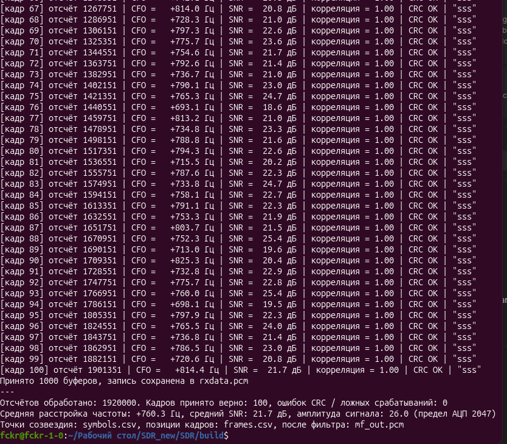
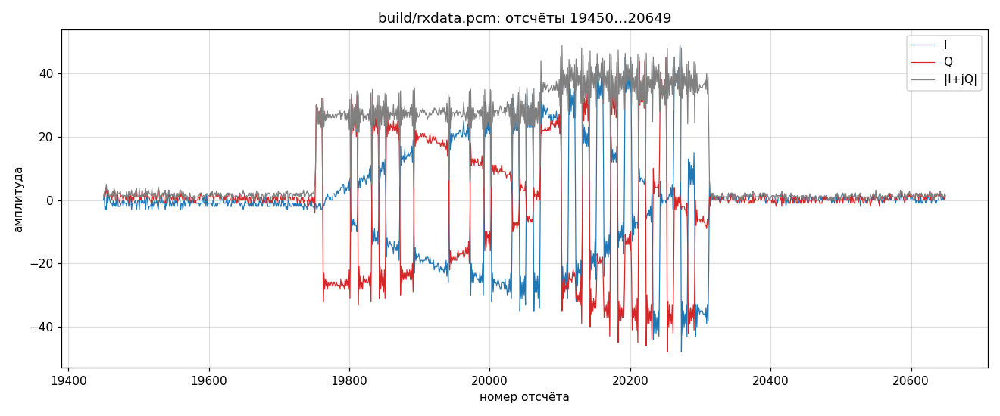
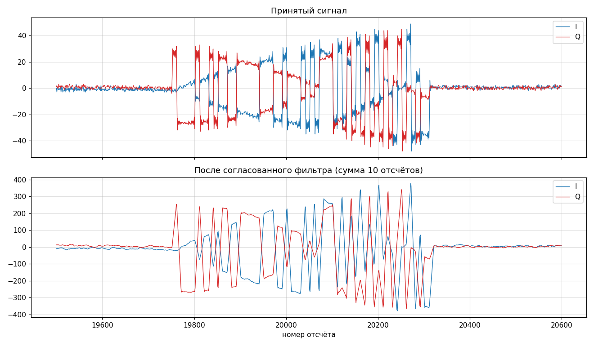
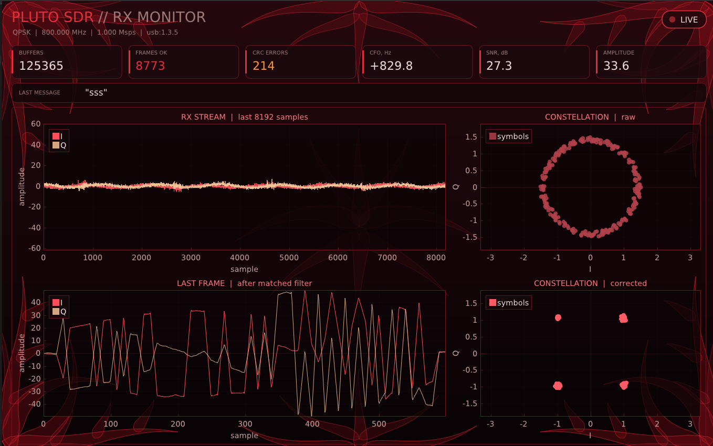
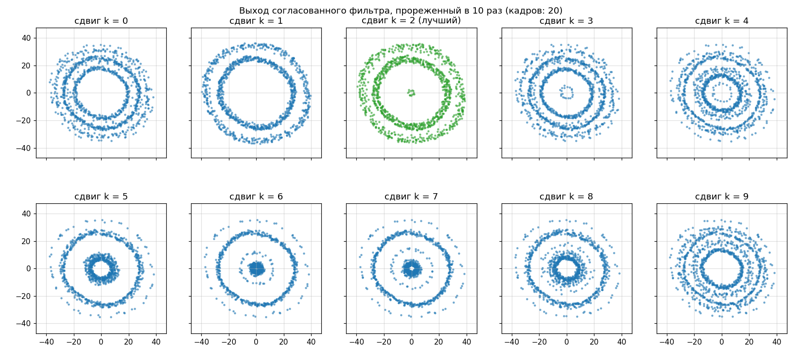
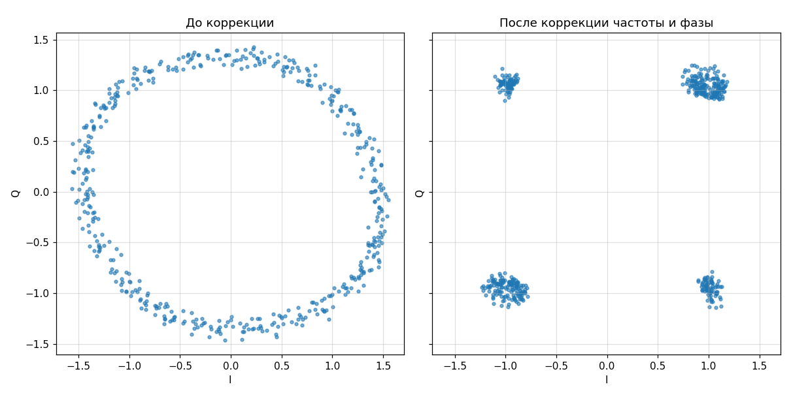

# Тема практической работы: приём — согласованный фильтр, выбор символьных отсчётов, синхронизация и демодуляция

## Цель работы

1. Реализовать приёмник цифровой связи: согласованная фильтрация, поиск кадра, выбор символьных отсчётов.
2. Визуализировать созвездие и объяснить, почему принятые точки вращаются.
3. Скорректировать расстройку частоты и фазу, демодулировать сигнал, проверить CRC и получить переданный текст.

## Теория

**Согласованный фильтр.** Для прямоугольного импульса длительностью SPS отсчётов согласованным является фильтр с той же характеристикой h = {1,…,1}: он суммирует SPS последних отсчётов
(в программе результат делится на SPS, чтобы амплитуда символа сохранялась). Выход максимален в момент окончания символа — в этот момент берётся символьный отсчёт.
Фильтр повышает отношение сигнал/шум примерно в SPS раз.

**Выбор символьных отсчётов.** Начало символа приёмнику заранее неизвестно. Выход фильтра прореживают в SPS раз со сдвигом k = 0…SPS−1 и смотрят,
при каком k точки собираются наиболее компактно. Скрипт `scripts/plot_constellation.py` рисует все 10 сдвигов для найденных кадров.

**Расстройка частоты.** У передающей и приёмной плат разные опорные генераторы, поэтому несущие немного отличаются. В результате принятые символы медленно вращаются
на комплексной плоскости. Кроме того, у каждого кадра своя начальная фаза несущей, поэтому при наложении нескольких кадров точки четырёх позиций QPSK размазываются в кольцо.

**Синхронизация по преамбуле.** Преамбула p[k] (32 BPSK-символа) известна приёмнику.

1. *Поиск кадра.* Для каждого положения t считается нормированная корреляция разностей соседних символов:

   `M(t) = | Σ y[k+1]·conj(y[k])·p[k+1]·p[k] | / E`.

   Расстройка частоты поворачивает все разности на один угол, поэтому модуль суммы от неё не зависит. Кадр найден, если M(t) ≥ 0,7; положение максимума задаёт и тактовую синхронизацию.
2. *Оценка частоты.* Угол суммы θ — поворот фазы за один символ: `Δf = θ · Rs / (2π)`, где Rs = fs / SPS = 100 кГц.
3. *Оценка фазы и амплитуды* по корреляции преамбулы после компенсации частоты. Она же снимает неоднозначность фазы QPSK.
4. *Слежение за фазой* в данных — петля Костаса по решениям.

**Демодуляция и проверка.** Знак I (и Q для QPSK) даёт биты; из первого байта берётся длина, затем данные и CRC-16. Кадр считается принятым только при совпадении CRC.
Приёмник работает потоково: кадр может начаться в одном буфере из 1920 отсчётов, а закончиться в следующем.

## Ход работы

Реализация: `include/rx_dsp.hpp`, `src/rx_dsp.cpp` (класс `StreamDecoder`); программа `src/lab4_rx.cpp`.

### 1. Приём и демодуляция

Передатчик запущен как в лабораторной №3, приёмник принимает 1000 буферов:
```bash
./lab4_rx --mod qpsk --uri usb:1.4.5 --buffers 1000
```
Для каждого кадра печатаются номер отсчёта начала, расстройка частоты (CFO), SNR, корреляция с преамбулой и текст.
Все принятые кадры проходят проверку `CRC OK`, текст совпадает с переданным; SNR кадров порядка 15–20 дБ, расстройка частоты порядка сотни герц, амплитуда сигнала порядка 10 единиц АЦП.

<p align="center">
  
</p>

Принятый кадр во времени (I — синий, Q — красный, серым — модуль). Первые 320 отсчётов — преамбула (BPSK): энергия в основном в I, Q около нуля.
Далее идут данные QPSK, где I и Q принимают значения ±A, а модуль заметно выше (примерно в √2 раза). Длина кадра 560 отсчётов = 56 символов × 10 (32 символа преамбулы и 24 символа данных).

<p align="center">
  
</p>

### 2. Сигнал до и после согласованного фильтра

После приёма `lab4_rx` сохраняет сигнал после согласованного фильтра в `mf_out.pcm` (сумма 10 отсчётов, без деления). Скрипт `plot_mf_compare.py` рисует один и тот же участок записи до и после фильтра:
```bash
python3 ../scripts/plot_mf_compare.py --start 1334000
```
Шум после фильтра заметно меньше, а прямоугольные импульсы символов превращаются в «треугольники» с вершиной в конце каждого символа, там, где берётся символьный отсчёт.

<p align="center">
  
</p>

### 3. Окно в реальном времени

Параметр `--gui` открывает окно ImGui/ImPlot в тёмно-красной теме с неотрайбл-орнаментом на фоне. Приём идёт в отдельном потоке, окно только отображает данные. В окне четыре графика: принятые отсчёты, последний кадр после согласованного фильтра и два графика справа. Их содержимое выбирается панелью управления:
`Symbols` (кольцо до коррекции и четыре точки QPSK после), `Trajectory` (путь сигнала после фильтра), `Offset` (точки при сдвиге выборки 0..9 внутри символа; при сдвиге 5 вместо четырёх точек получается сетка 3×3, потому что фильтр усредняет два соседних символа)
и `Live XY` (живые I/Q с антенны).
```bash
./lab4_rx --mod qpsk --uri usb:1.4.5 --buffers 0 --gui
```

<p align="center">
  
</p>

### 4. Выбор символьных отсчётов и созвездие

```bash
python3 ../scripts/plot_constellation.py rxdata.pcm
```
Сетка из 10 графиков: выход согласованного фильтра, прореженный в 10 раз со сдвигами k = 0…9, только для найденных кадров. При правильном сдвиге (выделен зелёным)
точки лежат на тонких кольцах; при остальных сдвигах в отсчёт попадает часть соседнего символа, и точки размазываются.
Внутреннее кольцо — преамбула (BPSK), внешнее — данные QPSK (модуль больше в √2 раз).

<p align="center">
  
</p>

Созвездие данных до и после коррекции частоты и фазы. До коррекции точки образуют кольцо, потому что у разных кадров разная фаза несущей. После коррекции видны четыре компактных кластера
QPSK в позициях (±1, ±1).

<p align="center">
  
</p>

## Вывод

Я реализовал приёмник: согласованный фильтр, поиск кадра по преамбуле, выбор символьного отсчёта, оценку и компенсацию расстройки частоты и фазы, демодуляцию BPSK/QPSK и проверку CRC.
На реальных платах переданный текст принят без ошибок. На графиках видно, как правильный сдвиг даёт чёткие кольца, а коррекция частоты и фазы собирает созвездие в четыре точки QPSK.
