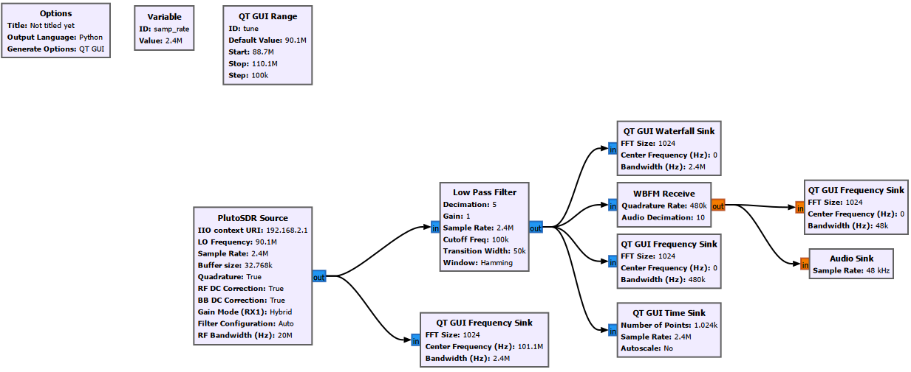
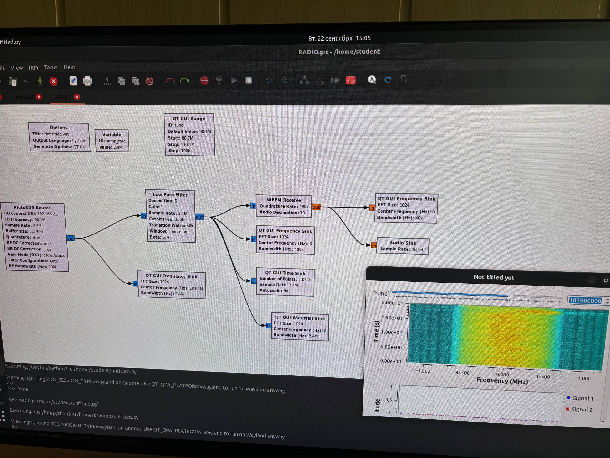

# Лабораторная работа № 1

## Тема
Архитектура Adalm Pluto SDR. Знакомство с GNU Radio Companion. Построение FM-радиоприёмника.

---

## 1. Цель работы

Изучить базовую архитектуру SDR-платформы Adalm Pluto, освоить среду
GNU Radio Companion и собрать работающий широкополосный FM-приёмник.

---

## 2. Краткие теоретические сведения

**SDR (Software Defined Radio)** — подход, при котором основная обработка
радиосигнала (фильтрация, демодуляция, декодирование) выполняется
программно на ПК, а аналоговая часть сведена к минимуму.

**Adalm Pluto SDR** — учебная SDR-платформа на базе трансивера AD9363.
Подключается по USB, взаимодействует с ПК через библиотеку Libiio.
Позволяет принимать и передавать сигналы в диапазоне 325 МГц – 3,8 ГГц.

**GNU Radio Companion (GRC)** — графическая среда для построения
радиотрактов из готовых блоков. Каждый блок — отдельный модуль
(источник, фильтр, демодулятор, sink и т. д.), соединяемый потоками
данных.

---

## 3. Описание собранной схемы

В GRC был построен тракт широкополосного FM-приёмника. Ниже перечислены
основные блоки и их назначение.

| Блок | Назначение |
|------|-----------|
| **PlutoSDR Source** | Приём IQ-отсчётов с реального устройства. Задаётся `IIO context URI`, несущая частота и частота дискретизации (`samp_rate`). |
| **QT GUI Range** | Ползунок для интерактивной перестройки частоты приёма. |
| **QT GUI Frequency Sink** | Отображение спектра принимаемого сигнала в реальном времени — позволяет визуально найти FM-станцию. |
| **Low Pass Filter** | Подавление внеполосных составляющих. Частота среза ≈ 100 кГц (полуширина канала FM). Децимация понижает `samp_rate` до ~48 кГц для аудио. |
| **QT GUI Time Sink** | Осциллограмма сигнала после фильтрации. |
| **WBFM Receive** | Демодуляция широкополосного FM-сигнала. Внутренний дециматор согласован с аудио-рейтом. |
| **Audio Sink** | Вывод демодулированного звука на динамики / наушники. |

Общий вид flowgraph:

---

## 4. Ход выполнения и возникшие трудности

**Оборудование и ПО:**
- Adalm Pluto SDR + USB-кабель
- Наушники / динамики
- GNU Radio Companion (установлен через Radioconda)

### Проблема 1 — некорректная прошивка Pluto SDR

После первого запуска flowgraph в терминале появились сообщения об
ошибках обмена данными с устройством, а в динамиках слышался лишь
белый шум. Замена экземпляра Pluto SDR на устройство с актуальной
прошивкой частично устранила проблему — сигнал стал чище, но
перестройка частоты по-прежнему не работала.

### Проблема 2 — неверный идентификатор в QT GUI Range

Ползунок частоты в графическом окне не влиял на реальную настройку
приёмника. При проверке параметров блока `QT GUI Range` выяснилось,
что в поле **ID** было введено число вместо строкового имени
переменной (например, `freq`). После исправления ID и привязки этой
переменной к параметру `Center Freq` блока `PlutoSDR Source`
перестройка заработала корректно.

---

## 5. Результат

После устранения описанных выше проблем FM-приёмник стабильно
принимал эфирные радиостанции. Перемещение ползунка частоты
позволяло переключаться между станциями в FM-диапазоне,
аудиосигнал воспроизводился без заметных искажений.

---

## 6. Вывод

В ходе лабораторной работы я ознакомился с архитектурой SDR-платформы
Adalm Pluto SDR и средой GNU Radio Companion. Был собран
широкополосный FM-приёмник, включающий источник IQ-данных,
фильтр низких частот, FM-демодулятор и аудиовыход. На практике
отработаны навыки отладки flowgraph и взаимодействия с реальным
SDR-оборудованием.

---

## 7. Источники

1. GNU Radio — What Is GNU Radio? — <https://wiki.gnuradio.org/index.php/What_Is_GNU_Radio>
2. Установка GNU Radio (Windows) — <https://wiki.gnuradio.org/index.php/WindowsInstall>
3. Radioconda — <https://github.com/ryanvolz/radioconda>
4. PlutoSDR Source — <https://wiki.gnuradio.org/index.php/PlutoSDR_Source>
5. QT GUI Frequency Sink — <https://wiki.gnuradio.org/index.php/QT_GUI_Frequency_Sink>
6. Low Pass Filter — <https://wiki.gnuradio.org/index.php/Low_Pass_Filter>
7. WBFM Receive — <https://wiki.gnuradio.org/index.php/WBFM_Receive>