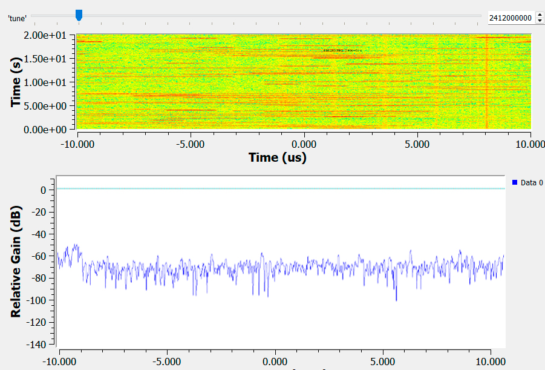

# Лабораторная работа № 2

## Тема
GNU Radio. Построение радио-приёмника и радио-передатчика.
Исследование диапазона 2,4 ГГц.

---

## 1. Цель работы

1. Освоить приём радиосигналов в диапазоне Wi-Fi (2,4 ГГц) с помощью
   Adalm Pluto SDR.
2. Собрать в GNU Radio Companion схему для визуализации
   радиочастотного спектра.
3. Обнаружить работающую мобильную точку доступа и определить её
   несущую частоту.

---

## 2. Теоретическая справка

**Wi-Fi (IEEE 802.11)** использует нелицензируемые ISM-диапазоны,
в частности полосу 2,400–2,483 ГГц. Данные передаются короткими
пакетами, поэтому мощность сигнала в канале непостоянна во времени.

**Waterfall Sink** — блок визуализации в GNU Radio, который строит
спектрограмму: по горизонтальной оси отложена частота, по вертикальной —
время, а интенсивность цвета отражает уровень мощности. Это удобный
инструмент для обнаружения кратковременных и периодических излучений.

**Adalm Pluto SDR** в режиме приёма оцифровывает полосу радиочастотного
сигнала и передаёт IQ-отсчёты на ПК по USB. Ширина мгновенной полосы
приёма ограничена ~20 МГц, что достаточно для наблюдения нескольких
Wi-Fi-каналов одновременно.

---

## 3. Ход работы

В GNU Radio Companion была построена следующая схема:

- **PlutoSDR Source** — источник IQ-данных. Частота дискретизации
  `samp_rate = 10 МГц`, полоса приёма (RF bandwidth) — 20 МГц.
- **QT GUI Range** — ползунок для перестройки центральной частоты
  в пределах 2,400–2,480 ГГц с шагом 1 МГц.
- **QT GUI Waterfall Sink** — спектрограмма для визуального анализа
  эфира.

После запуска flowgraph и включения мобильной точки доступа на
спектрограмме отчётливо наблюдались всплески мощности,
соответствующие передаче Wi-Fi-пакетов. Перемещая ползунок частоты,
удалось локализовать канал, на котором работала точка доступа.

---

## 4. Результат

На спектрограмме зафиксирована активность в диапазоне 2,4 ГГц.
Ярко выраженные горизонтальные полосы соответствуют несущим
частотам Wi-Fi-каналов; прерывистый характер свечения отражает
пакетную природу передачи данных.

  

---

## 5. Вывод

В ходе работы я настроил Adalm Pluto SDR на диапазон 2,4 ГГц и
собрал в GNU Radio Companion схему с Waterfall Sink для наблюдения
спектра Wi-Fi. Удалось визуально обнаружить работающую мобильную
точку доступа и оценить характер её излучения. Для более точного
определения несущей частоты необходимо синхронизировать центральную
частоту источника с серединой шкалы водопада и, при необходимости,
уменьшить полосу обзора.

---

## 6. Источники

1. GNU Radio — What Is GNU Radio? — <https://wiki.gnuradio.org/index.php/What_Is_GNU_Radio>
2. PlutoSDR Source — <https://wiki.gnuradio.org/index.php/PlutoSDR_Source>
3. QT GUI Waterfall Sink — <https://wiki.gnuradio.org/index.php/QT_GUI_Waterfall_Sink>
4. Radioconda — <https://github.com/ryanvolz/radioconda>