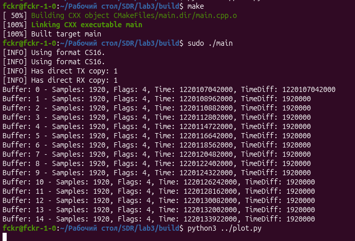
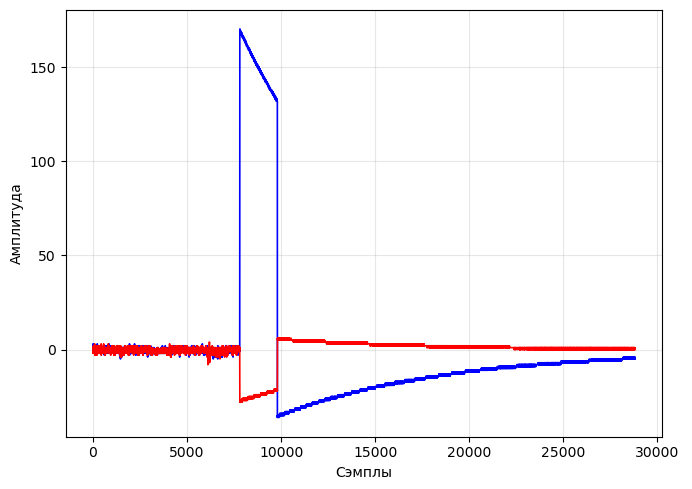

# Отчёт по производственной практике

## Занятие №3: Низкоуровневая работа с Adalm Pluto SDR через библиотеку SoapySDR

> **Выполнил:** Золотухин А. А.

---

### 1. Цель работы
1. Освоить прямое программное взаимодействие с Adalm Pluto SDR на C++ с помощью библиотеки `SoapySDR` без применения среды GNU Radio.
2. Настроить параметры радиочастотного тракта (приём/передача, частота дискретизации, усиление).
3. Реализовать механизм аппаратной синхронизации приёма и передачи по временным меткам (Timestamps).
4. Записать полученные IQ-отсчёты в файл и построить их временные диаграммы средствами Python.

---

### 2. Ход выполнения работы

#### Программный стек и настройка
Для работы с SDR в C++ используется связка библиотек `libiio` (базовый драйвер Analog Devices) и `SoapySDR` (универсальный фреймворк для работы с SDR-устройствами).

В ходе выполнения работы на C++ было разработано приложение, выполняющее следующие операции:
- Инициализация устройства привязочным URI `usb:`.
- Задание несущей частоты 800 МГц и частоты дискретизации 1 МГц для каналов RX и TX.
- Настройка потоков передачи в формате `SOAPY_SDR_CS16` (комплексные 16-битные числа).
- Последовательное считывание 10 буферов приема размером по 1920 сэмплов каждый.
- Формирование TX-пакета и планирование его отправки в эфир на 3-й итерации со смещением `+4 мс` относительно метки времени приема.

#### Запуск и запись данных
Программа скомпилирована с помощью CMake и запущена в операционной системе Ubuntu Linux. В ходе работы программы вывод в консоль подтвердил корректное считывание отсчётов с постоянной разницей во времени `TimeDiff = 1920000 нс` (1.92 мс), что в точности соответствует размеру буфера 1920 отсчётов при `sample_rate = 1 МГц`.

Все принимаемые IQ-отсчёты были записаны в бинарный файл `txdata.pcm`.

---

### 3. Анализ результатов (Визуализация IQ)

Для чтения файла `txdata.pcm` и построения графиков был использован скрипт на Python. Файл декодирован в массив 16-битных целых чисел, разделенных на синфазную ($I$) и квадратурную ($Q$) составляющие.

На графике отчётливо наблюдается всплеск амплитуды $I$ и $Q$ компонентов в момент срабатывания передатчика, отправленного по вычисленной аппаратной метке времени.

---

### 4. Вывод
В ходе лабораторной работы я освоил базовые методы низкоуровневой работы с трансивером Adalm Pluto SDR через API библиотеки `SoapySDR`. Были успешно настроены каналы приёма/передачи, отработана отправка данных с привязкой к аппаратным меткам времени (Timestamp) и выполнена визуализация сигналов в Python.